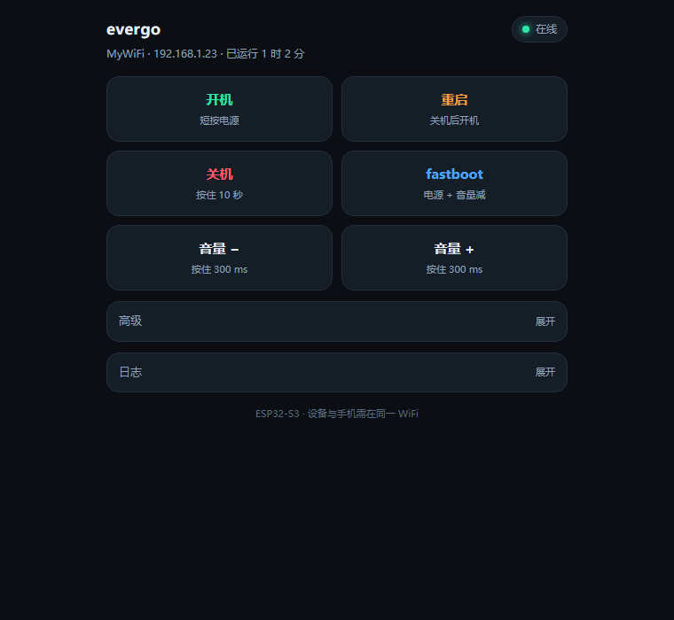
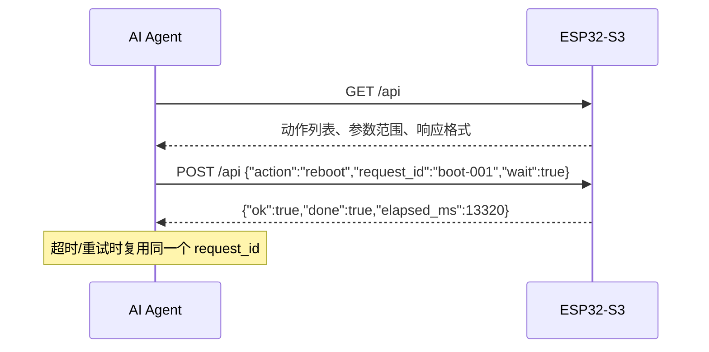

<div align="center">

# evergo reboot helper

**用 ESP32-S3 远程按手机按键 · 人和 AI 都能轻松调用的 HTTP API**

[](https://docs.espressif.com/projects/esp-idf/zh_CN/latest/esp32s3/)
[](https://www.espressif.com/zh-hans/products/socs/esp32-s3)
[](#-常见问题)
[](#-http-api-v20)
[](#-给-ai-agent-的调用指南)
[](LICENSE)

</div>

> 一块 40 × 18 mm 的 ESP32-S3 Super Mini，通过三路 MOSFET 短接手机的 **电源 / 音量减 / 音量加**，让你在 PC、脚本或 AI Agent 里用一条 HTTP 请求完成开机、关机、重启、进 fastboot。

<p align="center">
  
</p>

---

## ✨ 特性

- 🖥️ **一屏网页控制台** —— 手机或电脑打开即用，不依赖外网、字体、CDN
- 🤖 **AI 友好 API** —— `GET /api` 自描述，Agent 无需读源码即可发现全部动作与参数范围
- 🔁 **幂等重试** —— `request_id` 在 30 秒内只执行一次，网络超时重试不会重复按键
- ⏳ **同步等待** —— `wait=1` 最多阻塞 30 秒，动作完成才返回，Agent 不用自己轮询
- 📊 **结果回执** —— `/status` 的 `last` 字段带最近一次动作、耗时和 `request_id`
- 🚦 **冲突保护** —— 同时只允许一个动作，冲突返回 `409` + `retry_after_ms`
- 💡 **RGB 反馈** —— 板载 WS2812 用颜色提示开机 / 关机 / 重启 / fastboot
- 🧩 **零外部组件** —— 连 JSON 解析器都是自带的小模块，构建不需要联网拉包

## 🧭 系统架构


动作是**串行**的：任意时刻只有一个按键序列在执行，第二个请求会被明确拒绝而不是排队，避免出现半截组合键。

## 🔌 硬件接线

| ESP32 引脚 | 经过 | 接到 |
|---|---|---|
| GPIO4 | 1 kΩ → 2N7002 栅极 | 漏极 → 手机 **POWER** 按键线 |
| GPIO5 | 1 kΩ → 2N7002 栅极 | 漏极 → 手机 **VOL DOWN** 按键线 |
| GPIO6 | 1 kΩ → 2N7002 栅极 | 漏极 → 手机 **VOL UP** 按键线（可选） |
| GND | — | 所有 MOSFET 源极 **以及手机 GND** |

MOSFET 是开漏接法：GPIO 拉高 → 按键线被拉到 GND → 视为“按下”。

> [!WARNING]
> 绝不要把电压灌进手机按键线——按键线工作在 1.8 V，只能被短接到地。
> 手机与 ESP32 必须共地，USB 线插在同一台电脑上时天然共地。

2N7002（SOT-23）就够用，按键电流只有微安级。手头只有三极管时，2N3904 按同样方式接（基极串 1 kΩ，发射极接地）。

## 🚀 快速开始

### 1. 准备环境

- ESP-IDF **v6.1**（`C:\esp\v6.1\esp-idf` 为本项目使用的环境）
- 一块 ESP32-S3 Super Mini（4 MB Flash）

```bash
git clone https://github.com/Evergo-Mainline/-esp32-s3-agent-reset-finger.git
cd -- -esp32-s3-agent-reset-finger
```

### 2. 配置 WiFi

先复制模板，再填入自己的 2.4 GHz 网络（`main/wifi_config.h` 已被 `.gitignore` 忽略，真实凭据不会进入仓库）：

```powershell
Copy-Item main\wifi_config.h.example main\wifi_config.h
```

```c
#define WIFI_SSID_PRIMARY   "your-wifi"       /* 首选 2.4 GHz SSID */
#define WIFI_SSID_ALT1      "your-wifi-alt1"  /* 连不上时的备选 */
#define WIFI_SSID_ALT2      "your-wifi-alt2"
#define WIFI_PASSWORD       "your-password"
```

> ESP32-S3 只支持 **2.4 GHz**，请不要填 5 GHz 专用 SSID。
> 仓库里的 `wifi_config.h.example` 只是模板，真实密码永远不要提交。

### 3. 构建 & 烧录

```powershell
$env:PYTHONUTF8 = '1'
. 'C:\Espressif\tools\Microsoft.v6.1.PowerShell_profile.ps1'

idf.py build
idf.py -p COM<n> flash monitor
```

或者直接运行脚本（自动选第一个串口，构建 + 烧录 + 开监视器）：

```powershell
.\flash.ps1
```

### 4. 打开控制台

串口日志会打印设备 IP：

```text
I (4141) helper: connected to 'MyWiFi'
I (4141) helper: http server on port 80
I (4141) helper: ready: http://192.168.1.23/api
```

浏览器访问 `http://<设备IP>/` 即可；AI Agent 建议从 `http://<设备IP>/api` 开始。

## 🖥️ Web 控制台

- 顶部状态灯：**在线 / 执行中 / 离线**，并显示 SSID、IP、运行时长
- 四个主按钮：**开机 / 重启 / 关机 / fastboot**
- 音量键：按住时长跟随「高级」里的设置
- **高级**：自定义电源/音量按压时长、fastboot 时序（可折叠）
- **日志**：请求日志（可折叠）

页面源码在 [`web/index.html`](web/index.html)，编译时由 [`tools/gen_web_page.py`](tools/gen_web_page.py) 生成 [`main/web_page.h`](main/web_page.h)，**不要手动改头文件**。改了 HTML 后 CMake 会自动重新生成并重编。

## 🌐 HTTP API v2.0

### 端点总览

| 方法 | 路径 | 说明 |
|---|---|---|
| `GET` | `/` | 网页控制台 |
| `GET` | `/api` | **自描述文档**：动作、参数、范围、响应格式、示例 |
| `GET` | `/status` | 设备状态、忙闲信息、最近一次动作结果 |
| `GET` | `/<action>` | 执行动作，参数走查询串 |
| `POST` | `/api` | 执行动作，参数走 JSON 请求体（**推荐 AI 使用**） |

### 动作列表

| action | 说明 | 参数（默认值） |
|---|---|---|
| `ping` | 连通性测试，**不操作手机** | `ms` 0–15000（0） |
| `on` | 短按电源键，开机 | — |
| `off` | 长按电源键 10 秒，强制关机 | — |
| `reboot` | 强制关机 → 等待 3 秒 → 短按电源 | — |
| `fastboot` | 电源 + 音量减组合键进入 fastboot | `power` 500–10000（4000）、`hold` 100–10000（1000）、`off` 是否先关机（true） |
| `power` | 按电源键指定时长 | `ms` 20–15000（300） |
| `voldown` | 按音量减键指定时长 | `ms` 20–15000（300） |
| `volup` | 按音量加键指定时长 | `ms` 20–15000（300） |

### 查询状态

```bash
curl http://<ip>/status
```

```json
{
  "ssid": "MyWiFi",
  "ip": "192.168.1.23",
  "heap": 261904,
  "uptime_s": 41,
  "busy": false,
  "action": "",
  "busy_for_ms": 0,
  "last": {
    "action": "reboot",
    "ok": true,
    "elapsed_ms": 13320,
    "ago_ms": 5200,
    "request_id": "boot-001"
  }
}
```

| 字段 | 说明 |
|---|---|
| `busy` | 是否有动作正在执行 |
| `action` | 正在执行的动作名（空闲时为 `""`） |
| `busy_for_ms` | 当前动作已运行时长 |
| `last` | 最近一次动作；从未执行过时为 `null` |
| `last.request_id` | 该动作携带的 `request_id`（GET 无此参数时为空串） |
| `last.ago_ms` | 动作结束至今的毫秒数 |

### 执行动作（GET）

```bash
curl http://<ip>/on
curl http://<ip>/reboot
curl 'http://<ip>/fastboot?power=4000&hold=1000&off=1'
curl 'http://<ip>/power?ms=800'
curl 'http://<ip>/ping?ms=500&wait=1'          # 等待完成（阻塞最多 30 秒）
curl 'http://<ip>/reboot?request_id=boot-001' # 带幂等 ID
```

### 执行动作（POST `/api`，推荐）

请求体是一个**扁平 JSON 对象**：

```json
{
  "action": "fastboot",
  "power": 4000,
  "hold": 1000,
  "off": true,
  "wait": false,
  "request_id": "boot-001"
}
```

```bash
curl -X POST http://<ip>/api \
  -H 'Content-Type: application/json' \
  -d '{"action":"reboot","request_id":"boot-001","wait":true}'
```

响应示例：

```json
// 已受理（异步）
{"ok":true,"action":"reboot","accepted":true,"request_id":"boot-001"}

// wait=true 且已完成
{"ok":true,"action":"reboot","accepted":true,"done":true,"elapsed_ms":13320,"request_id":"boot-001"}

// wait=true 但等待超时（动作仍在后台执行）
{"ok":true,"action":"fastboot","accepted":true,"done":false,"pending":true,"request_id":"boot-002"}
```

### 错误与冲突

| HTTP | `error` | 含义 |
|---|---|---|
| `409` | `action_in_progress` | 已有动作在执行；按 `retry_after_ms` 等待后重试（同时带标准 `Retry-After` 头） |
| `400` | `bad_json` | 请求体不是合法的扁平 JSON 对象 |
| `400` | `missing_action` | 缺少 `action` 字段 |
| `400` | `unknown_action` | 动作名不存在，见 `GET /api` |
| `400` | `invalid_param` | 参数类型或范围不合法 |
| `400` | `invalid_request_id` | `request_id` 需为 1–40 个 `[A-Za-z0-9._:-]` 字符 |
| `404` | `not_found` | 路径不存在 |
| `413` | `body_too_large` | 请求体超过 512 字节 |

冲突响应示例：

```json
{
  "ok": false,
  "error": "action_in_progress",
  "action": "reboot",
  "busy_for_ms": 3200,
  "retry_after_ms": 10100
}
```

## 🤖 给 AI Agent 的调用指南

### 推荐流程



1. **发现**：`GET /api` 拿到全部动作和参数范围，不要硬编码猜测
2. **执行**：`POST /api`，为每个用户意图生成唯一 `request_id`（UUID 或时间戳）
3. **等结果**：需要立刻知道成败就加 `"wait":true`；否则稍后 `GET /status` 看 `last`
4. **重试**：收到 `409` 时按 `retry_after_ms` 等待后重试；**重试必须复用同一个 `request_id`**
5. **确认**：`last.request_id` 与你的 ID 一致且 `elapsed_ms` 合理，即表示动作已完成

### 最小 curl 脚本

```bash
IP=192.168.1.23

# 1. 发现能力
curl -s http://$IP/api | python -m json.tool

# 2. 健康检查（不会碰手机按键，适合验证连通性）
curl -s "http://$IP/ping?ms=100&wait=1"

# 3. 重启手机并等待结果（最多 30 秒）
curl -s -X POST http://$IP/api \
  -H 'Content-Type: application/json' \
  -d '{"action":"reboot","request_id":"reboot-'"$(date +%s)"'","wait":true}'
```

### 给 Agent 的系统提示片段

```text
你可以通过 HTTP 控制一台连接着手机的 ESP32-S3：
- 先 GET http://<ip>/api 发现可用的动作和参数范围，不要调用列表外的动作。
- 执行动作用 POST http://<ip>/api，JSON 体形如
  {"action":"reboot","request_id":"<唯一ID>","wait":true}。
- 每次用户意图生成一个新的 request_id；同一次操作的重试必须复用同一个 ID。
- 收到 409 时等待 retry_after_ms 毫秒后再重试，不要立即重发。
- 收到 done:true 表示动作已完成；done:false 时用 GET /status 的 last 字段确认。
- ping 不操作手机，只用于连通性测试。
```

> [!NOTE]
> `wait=1` 期间 HTTP 服务被占用（最长 30 秒），此时网页轮询会短暂卡顿；不需要同步结果时请用异步模式。

## ⚙️ 配置说明

| 文件 | 作用 |
|---|---|
| [`main/wifi_config.h.example`](main/wifi_config.h.example) | WiFi 凭据模板；复制为 `main/wifi_config.h` 后填写（真实凭据已被 git 忽略） |
| [`sdkconfig.defaults`](sdkconfig.defaults) | ESP32-S3 目标、关闭任务看门狗、日志级别、HTTP 头长度 |
| [`main/main.c`](main/main.c) | GPIO 定义、动作时序、API 实现 |
| [`web/index.html`](web/index.html) | 控制台页面源码 |
| [`tools/gen_web_page.py`](tools/gen_web_page.py) | 把 HTML 嵌入为 C 字符串 |

编译时 `main/CMakeLists.txt` 会自动调用生成脚本；手动重新生成：

```powershell
python tools\gen_web_page.py
```

## 🗂️ 目录结构

```text
.
├── LICENSE                 # GPL-3.0
├── CMakeLists.txt          # 项目入口
├── sdkconfig.defaults      # 默认配置
├── flash.ps1               # 一键构建 + 烧录 + 监视器
├── main/
│   ├── CMakeLists.txt      # 组件定义 + 页面生成钩子
│   ├── main.c              # 按键时序、WiFi、HTTP API
│   ├── json_flat.c/.h      # 零依赖扁平 JSON 解析器
│   ├── web_page.h          # 由 web/index.html 生成，请勿手改
│   ├── wifi_config.h       # 本地 WiFi 凭据（未提交）
│   └── wifi_config.h.example  # 凭据模板
├── web/
│   └── index.html          # 控制台页面
├── tools/
│   └── gen_web_page.py     # HTML → C 字符串
└── docs/
    └── preview.png         # 控制台截图
```

## ❓ 常见问题

<details>
<summary><b>网页显示离线 / 打不开怎么办？</b></summary>

1. 确认 PC 和手机连的是同一个 WiFi，且该 WiFi 是 **2.4 GHz**
2. 看串口日志确认是否打印 `got ip` 和 `ready: http://…`
3. 用 `curl http://<ip>/status` 排查；IP 可能变化，以串口日志为准
</details>

<details>
<summary><b>为什么连不上 <code>MyWiFi_5G</code>？</b></summary>

ESP32-S3 只支持 2.4 GHz，5 GHz SSID 永远不会连上，请不要写进 `wifi_config.h`。
</details>

<details>
<summary><b>为什么按住按键时没有反应？</b></summary>

- 检查 MOSFET 方向、共地，以及是否误把电压接入按键线
- 动作是串行的，若正在执行其他动作会返回 `409`，等它结束再试
- 用 `GET /ping?ms=100` 先确认网络链路正常
</details>

<details>
<summary><b>改了 <code>web/index.html</code> 为什么页面没变？</b></summary>

重新执行 `idf.py build` 即可；CMake 会自动重新生成 `main/web_page.h` 并重编。
若想手动生成，运行 `python tools\gen_web_page.py`。
</details>

<details>
<summary><b>为什么把任务看门狗关了？</b></summary>

强制关机需要按住电源 10 秒，动作任务会长时间阻塞；任务看门狗会误报。因此
`sdkconfig.defaults` 中设置了 `CONFIG_ESP_TASK_WDT_EN=n`。
</details>

## 📝 设计说明

- **单动作串行**：`action_task` 独占按键序列，冲突请求返回 `409` 而不是排队，保证时序确定
- **幂等重试**：8 个 `request_id` 槽位、30 秒窗口，重试不会让手机被按第二次
- **同步等待**：`wait` 用 25 ms 轮询忙闲标志（比事件组更简单可靠），最长 30 秒
- **自描述 API**：`GET /api` 直接返回动作、参数、错误码和示例，降低 Agent 的接入成本
- **零外部依赖**：自带的 `json_flat` 只解析扁平对象，省掉 cJSON 依赖，固件更小
- **LED 颜色**：绿=开机、红=关机、橙=重启、蓝=fastboot、白=自定义按键、`ping` 不闪灯
- **无 mDNS**：ESP-IDF 6.1 中 mDNS 是需要联网拉取的管理组件，IP 直接由串口打印

## 📄 许可证

本项目采用 **GNU General Public License v3.0** 发布，完整条款见仓库根目录的 [`LICENSE`](LICENSE)。

- 你可以自由使用、修改、分发本项目，但分发衍生作品时需同样以 GPL-3.0 开源
- 源码文件头部带 `SPDX-License-Identifier: GPL-3.0-only` 标识

> [!IMPORTANT]
> `main/wifi_config.h` 含真实 WiFi 密码，已被 `.gitignore` 排除。
> 提交前请用 `git status` 确认它没有出现在变更列表中；仓库内只保留
> `main/wifi_config.h.example` 模板。
